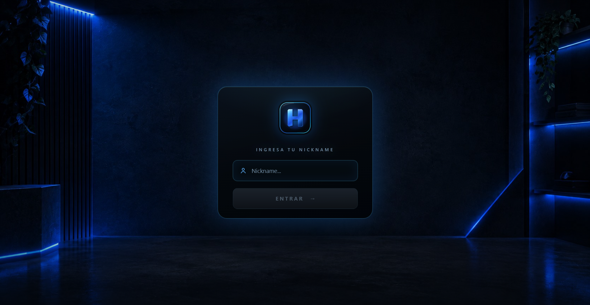
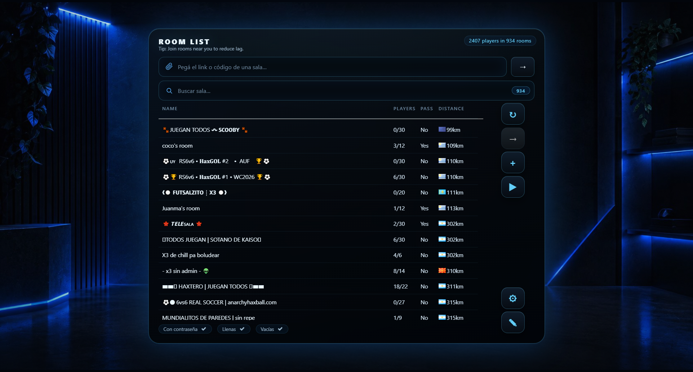
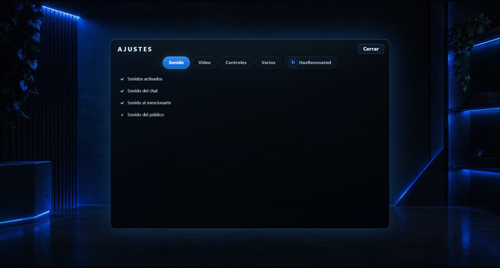

# HaxRenovated

Cliente de escritorio para **HaxBall** con una capa visual propia (interfaz oscura en azul eléctrico, pantalla de apodo personalizada y ajustes integrados), empaquetado con Electron para Windows.

> Proyecto no oficial. No está afiliado ni respaldado por HaxBall.

---

## Descarga

La app completa está en **[Releases](../../releases/latest)**:

1. Descarga `HaxRenovated-win64.zip`.
2. Descomprime la carpeta completa (no ejecutes desde dentro del `.zip`).
3. Ejecuta `HaxRenovated.exe`.

No requiere instalación ni permisos de administrador.

### Requisitos

- Windows 10 u 11, 64 bits
- Conexión a internet (la app carga el cliente web de HaxBall)

> **Antivirus:** al ser un ejecutable de Electron sin firma digital, algunos antivirus pueden marcarlo como sospechoso. Es un falso positivo habitual en apps empaquetadas sin certificado.

---

## Capturas

| Pantalla de apodo | Lista de salas |
|---|---|
|  |  |

| Ajustes | |
|---|---|
|  | |

---

## Contenido del repositorio

```
.
├── app.asar              # Paquete de la aplicación (código ofuscado + recursos)
├── docs/                 # Capturas y logo
└── README.md
```

`app.asar` es el paquete que Electron carga en tiempo de ejecución. El ejecutable y las dependencias de Chromium/Node van en el `.zip` del Release.

---

## Qué incluye

- Interfaz rediseñada en azul eléctrico y negro.
- Pantalla de apodo personalizada.
- Panel de ajustes propio (video, controles, audio, temas, avatar, pisos, pelotas).
- Temas de color y fondo neón.
- Optimizaciones de rendimiento para el cliente (flags de Chromium).
- Atajos de teclado y personalización de la sala.

---

## Aviso

Este proyecto es una modificación no oficial del cliente de HaxBall. Úsalo bajo tu responsabilidad y respeta las normas del servicio y de los servidores en los que juegues.

El código de la aplicación se distribuye empaquetado y ofuscado; no se incluye el código fuente en este repositorio.
